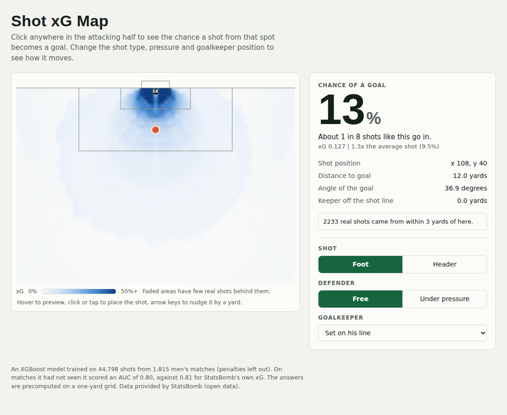
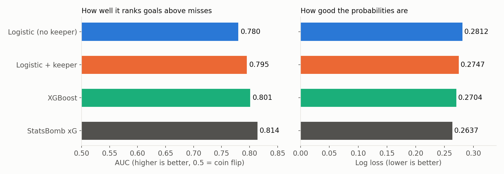
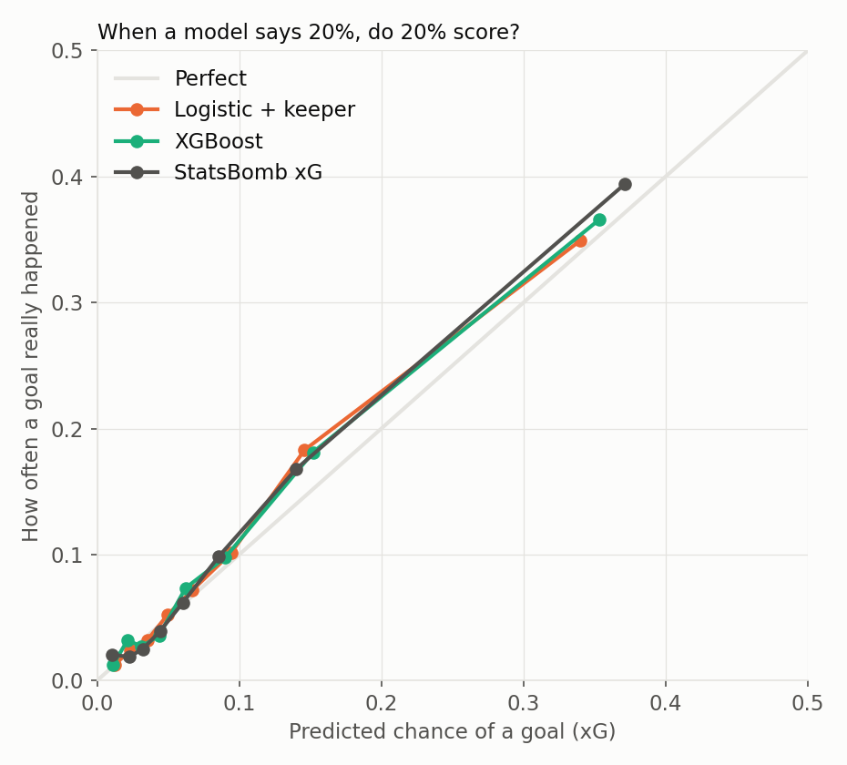
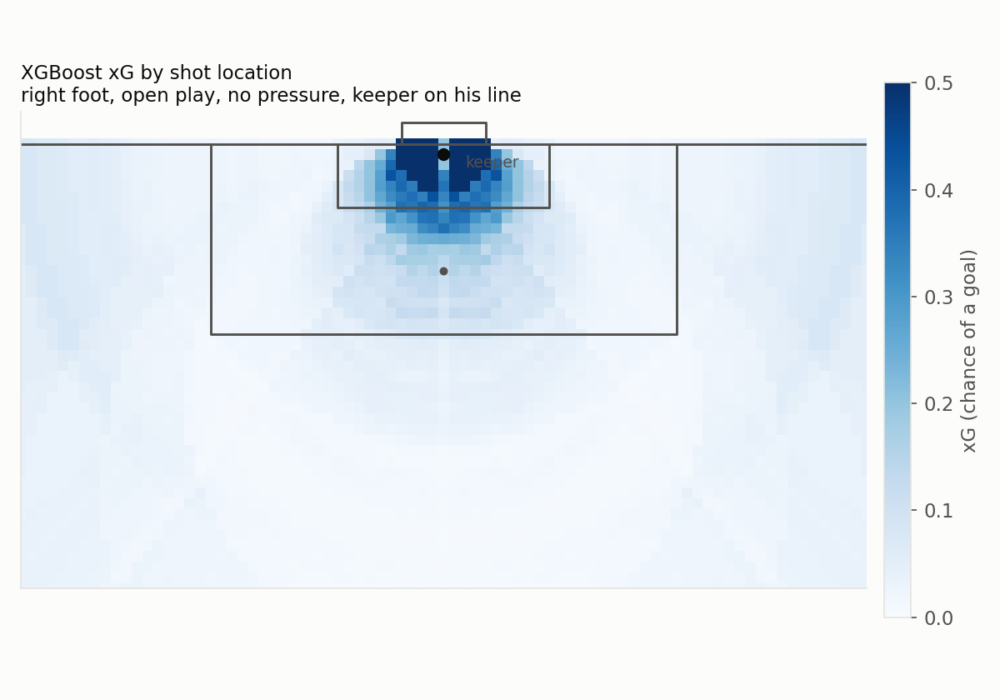

# xG Model

An expected goals (xG) model for football. Given where a shot is taken and where the goalkeeper stands, it predicts the chance the shot is a goal. I trained it on StatsBomb's free open data and built a clickable pitch to explore it.



## Results

Test set: 20% of matches, held out by match so no game appears in both training and testing.

| Model | AUC | Log loss | Predicted goals | Real goals |
|---|---|---|---|---|
| Logistic regression (no keeper) | 0.780 | 0.2812 | 849 | 921 |
| Logistic regression + keeper | 0.795 | 0.2747 | 856 | 921 |
| XGBoost | 0.801 | 0.2704 | 854 | 921 |
| StatsBomb's own xG | 0.814 | 0.2637 | 855 | 921 |

- Goalkeeper position added about 0.015 AUC to the logistic regression.
- XGBoost added a further 0.006, which is within the noise I saw between different splits. This is one split, so I do not claim XGBoost is clearly better yet.
- The models are close to calibrated. When one predicts 20%, about 20% of those shots score.





## How it works

1. `download_data.py` pulls every shot from 1,815 men's matches (five leagues, two World Cups, two Euros). It keeps location, body part, shot type, pressure, the goalkeeper's position from the freeze frame, and the outcome. Penalties are left out. This gives `data/shots.csv`.
2. `train_model.py` builds the features and trains the models:
   - distance to the middle of the goal (Pythagoras)
   - the angle the goal takes up from the shot (law of cosines on the two posts)
   - header, free kick, under pressure, first time
   - how far the keeper is from the shooter, and how far he is off the straight line between the shooter and the goal
3. `make_plots.py` makes the results table and the three charts.
4. `build_app.py` runs XGBoost on every spot of the pitch ahead of time and writes the results into `app/index.html`. Open that file in a browser to use the clickable pitch. Spots with few real shots behind them are faded.

## Run it

```
pip install -r requirements.txt
python download_data.py    # optional, the data is already in data/
python train_model.py
python make_plots.py
python build_app.py
```

## Limits

- The data is only the matches StatsBomb released for free, so it is a sample. There are 4,260 goals in total.
- Defender positions are in the data but not used yet.
- Far from goal and near the goal line there are very few shots, so the model is guessing there.
- In the app the keeper can only sit in five preset spots, because the answers are precomputed.
- Model settings were chosen up front and not tuned on the test set. Results come from a single train/test split.

## Next

- Cross-validation to get steadier numbers.
- Defender features from the freeze frame.
- A live Python app so the keeper can be dragged anywhere.

## Data

Data provided by [StatsBomb](https://github.com/statsbomb/open-data) (open data). Read their user agreement before reusing it.
